<div align="center">


# Iris Checks

### Many eye checks. Just your phone.

A student research project building a 30-second phone scan that looks for signs linked to<br/>
**diabetic retinopathy**, **glaucoma** and **cataracts**, using only the front camera and the light from the screen.

[](https://irischecks.app)
[](https://nextjs.org)
[](https://react.dev)
[](https://ai.google.dev/edge/mediapipe)
[](LICENSE)

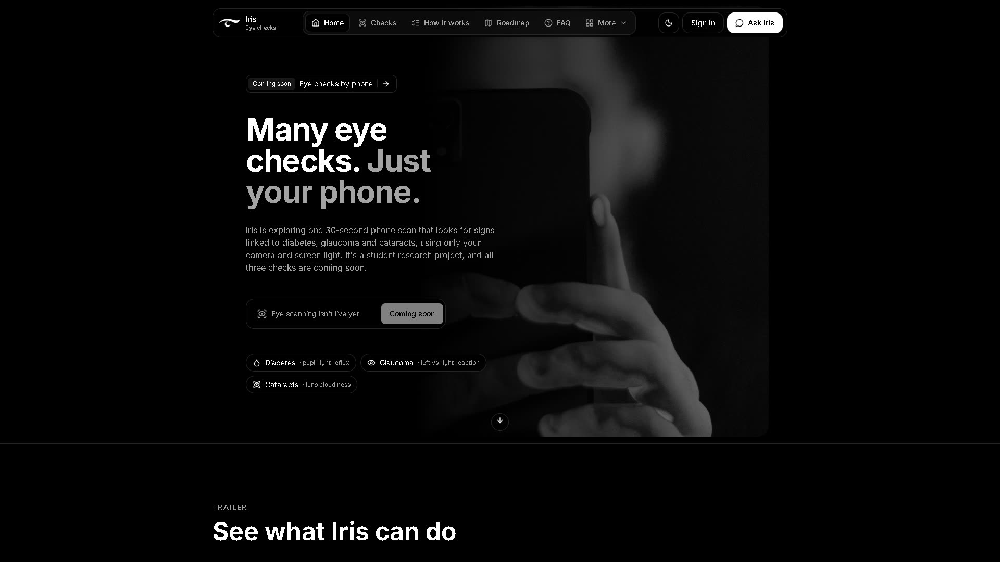

</div>

> [!IMPORTANT]
> **Iris is a research prototype, not a medical device.** It cannot diagnose or rule out any disease. Every result says either "looks typical" or "see a doctor", and anyone with eye pain, sudden vision changes or other worries should get a real eye exam.

---

## Contents

- [What Iris does](#what-iris-does)
- [The three checks](#the-three-checks)
- [Core features](#core-features)
- [How a scan works](#how-a-scan-works)
- [Screenshots](#screenshots)
- [Tech stack](#tech-stack)
- [Project structure](#project-structure)
- [Running it locally](#running-it-locally)
- [Research and data](#research-and-data)
- [Roadmap](#roadmap)
- [Privacy](#privacy)

---

## What Iris does

Eye diseases like glaucoma and diabetic retinopathy often cause no pain and no symptoms until vision is already lost. Most people who need a check never get one, because it means a clinic, a specialist and special equipment.

Iris asks a simpler question: **how much can an ordinary phone tell us?** The phone's screen becomes a flash, the front camera watches the pupils, and the app measures how they react. The same close-up photos are then checked for lens haze. No attachments, no extra hardware.

## The three checks

| | Check | What the phone measures | Where the science stands |
|:-:|---|---|---|
| 💧 | **Diabetic retinopathy** | Resting pupil size, and how far, how fast and how soon each pupil shrinks after a flash | Research question. Clinic pupillometer studies found differences in people with diabetes. |
| 👁️ | **Glaucoma** | How strongly the pupils react when only the left eye is lit vs only the right (a phone version of the swinging flashlight test) | Known test, new device. Early phone pupillometry studies are small but promising. |
| 🔍 | **Cataracts** | Whether the pupil looks hazy or grey instead of clear and dark | Best studied. Phone + AI studies matched eye doctors about 90% of the time. |

Each check returns one of four plain-language results: **looks typical**, **borderline**, **see a doctor**, or **unclear** (when the recording wasn't good enough to judge).

## Core features

### 📱 Pupil scan (`/dashboard/scan`)
The main 30-second test. MediaPipe's face landmarker finds both eyes in the live camera feed, Iris fits circles to the iris and pupil every frame, then flashes the screen and records the pupil light reflex. It measures:

- **Resting pupil ratio** (pupil size relative to the iris, converted to millimetres using the iris as a ruler)
- **Constriction amplitude, latency and velocity** after the flash
- **Left vs right reflex balance** and pupil size difference
- **Lens haze** in each eye's flash photo

Frames with blinks, blur or poor contrast are dropped. If fewer than half the frames are usable, or a reading is physically implausible, the result is marked *unclear* rather than guessed.

### 📸 Eye photo check (`/dashboard/eye-check`)
A guided close-up photo of the front of the eye, with a short symptom questionnaire first.

- **Live coaching** tells you to move closer, add light, hold still or avoid glare before the photo is taken
- **Red-flag triage**: symptoms like sudden vision loss or a chemical splash skip straight to "get urgent care"
- **On-device photo match**: a MobileNet V3 embedding of the photo is compared against 1,957 labelled reference images (normal, cataract, red eye, uveitis, eyelid problems)
- **AI review**: a vision model panel describes what is visible and what can't be assessed, with a fallback chain if the main model is unavailable

### 📊 Personal dashboard (`/dashboard`)
Signed-in users get a profile (age range, diabetes status, glasses, family history), a history of past scans with charts of their pupil metrics over time, and the option to delete any scan.

### 💬 Ask Iris assistant
A chat widget on every page that answers questions about the project and eye health basics. It retrieves the most relevant facts from a small knowledge base using embeddings, then answers in two to five plain sentences. It is told never to diagnose and to point health worries toward a doctor.

### 🧠 Explain my results
After a scan, Iris can turn the raw numbers into a short, plain-English explanation that compares them with published reference ranges and says what to do next.

### 🌐 Public site
- **Home**: hero, demo, the three checks, how the scan works, FAQ, roadmap and trailer
- **Research** (`/research`): the team's full research notebook with sources
- **Team**, **Press kit**, **Privacy** and **Terms** pages
- Light and dark themes, SEO metadata, sitemap and social preview images

## How a scan works

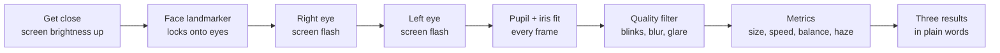

All image processing (face tracking, pupil fitting, haze measurement and photo embeddings) runs **in the browser on your device**. Only the resulting numbers are saved to your account.

## Screenshots

<table>
  <tr>
    <td align="center">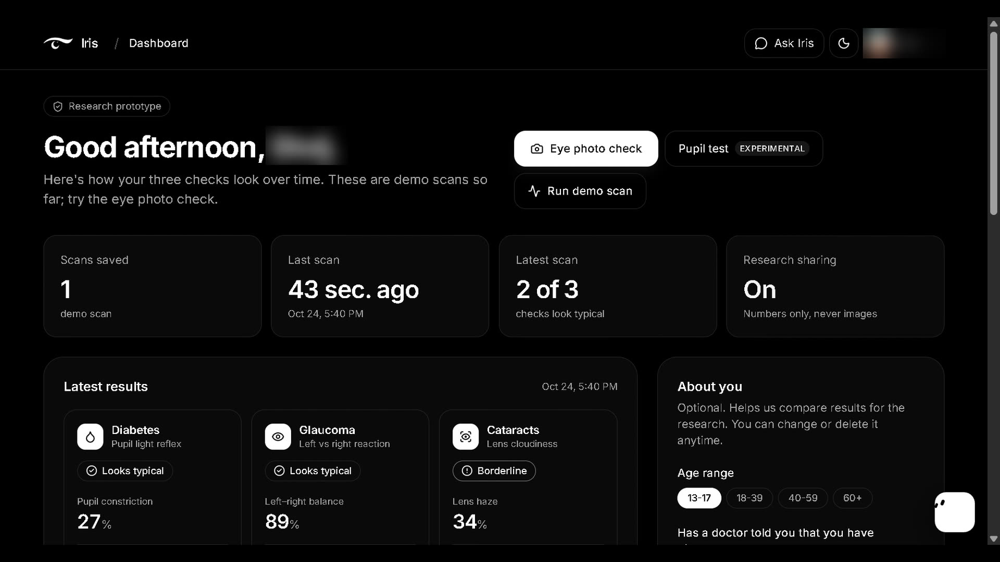<br/><sub><b>Dashboard</b></sub></td>
    <td align="center">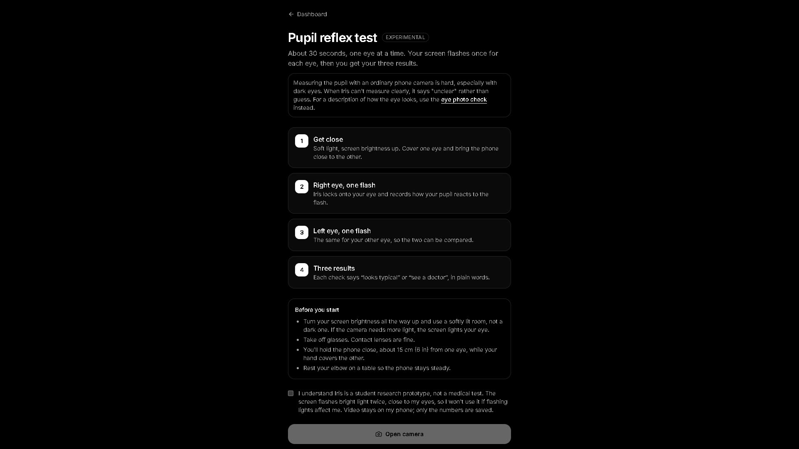<br/><sub><b>Pupil test</b></sub></td>
    <td align="center">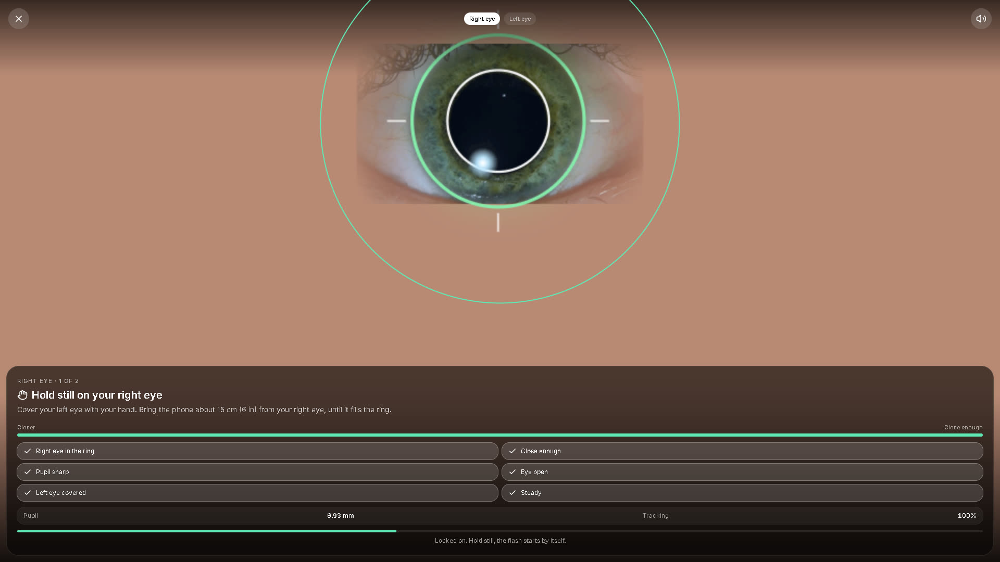<br/><sub><b>Eye locked on</b></sub></td>
  </tr>
  <tr>
    <td align="center">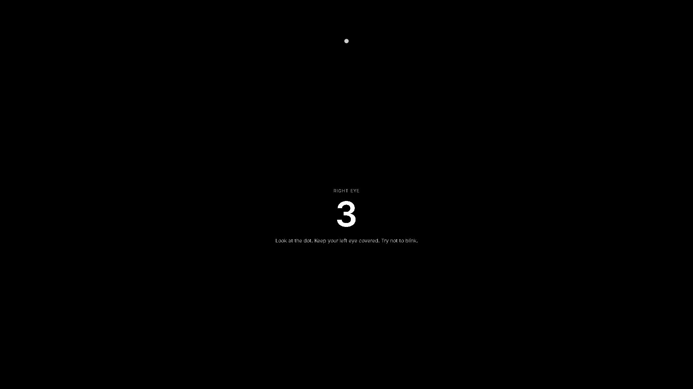<br/><sub><b>Countdown</b></sub></td>
    <td align="center"><br/><sub><b>Screen flash</b></sub></td>
    <td align="center">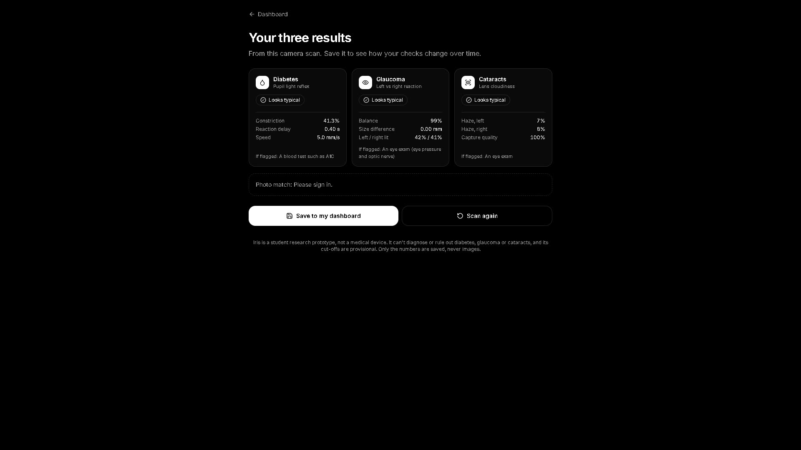<br/><sub><b>Results</b></sub></td>
  </tr>
  <tr>
    <td align="center">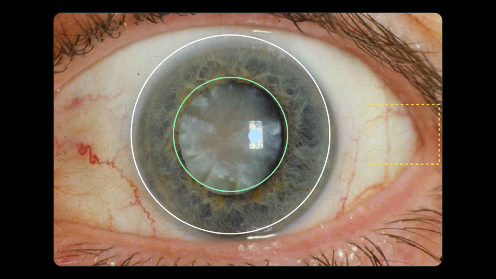<br/><sub><b>Cataract photo</b></sub></td>
    <td align="center">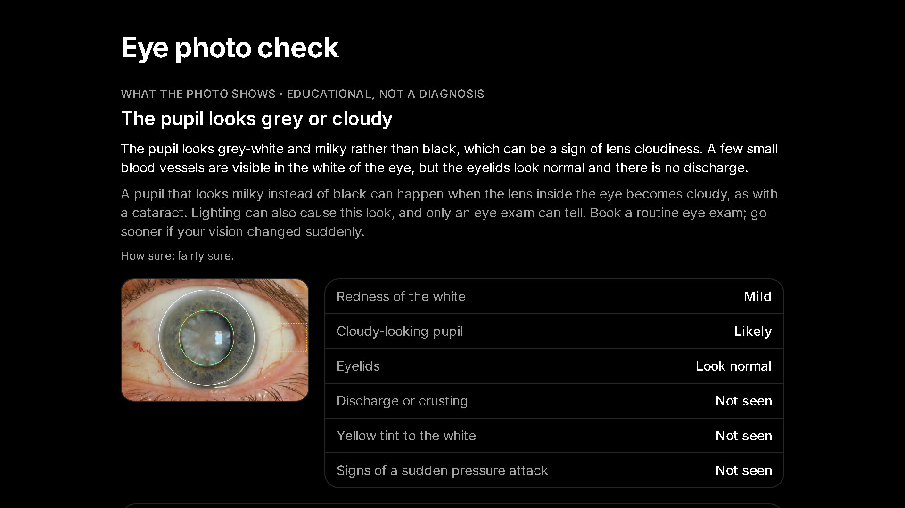<br/><sub><b>Cataract result</b></sub></td>
    <td align="center">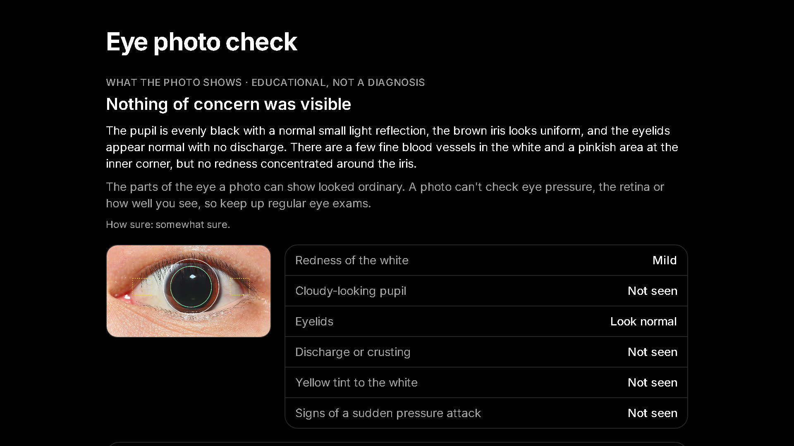<br/><sub><b>Healthy eye result</b></sub></td>
  </tr>
</table>

## Tech stack

| Layer | Tools |
|---|---|
| Framework | Next.js 16 (App Router), React 19, TypeScript |
| Styling | Tailwind CSS 4, Radix UI, Framer Motion, Lucide icons |
| Computer vision | MediaPipe Tasks Vision (face landmarker, MobileNet V3 image embedder), custom pupil and limbus fitting |
| Accounts | Clerk (email and social sign-in), JWT verification with `jose` |
| Database | Supabase Postgres (profiles, scans, reference embeddings) |
| AI | Hack Club AI proxy for chat, result explanations and photo review |
| Hosting | Vercel |

## Project structure

```
Iris-Checks/
├── iris-web/                 # The web app (everything that runs today)
│   ├── app/
│   │   ├── (account)/        # Sign-in, sign-up, dashboard, scan, eye check
│   │   ├── api/              # chat, explain, eye-check, photo-match, scans, me
│   │   └── research, team, press-kit, privacy, terms, scan
│   ├── components/
│   │   ├── scanner/          # Pupil scan camera, charts and results
│   │   ├── eye-check/        # Photo check camera and findings
│   │   ├── dashboard/        # Profile, scan history, charts
│   │   └── blocks/ ui/       # Landing page sections and UI kit
│   ├── lib/
│   │   ├── analysis.ts       # Pupil light reflex metrics
│   │   ├── pupil-fit.ts      # Pupil and iris circle fitting
│   │   ├── limbus.ts         # Iris edge detection
│   │   ├── scan-rating.ts    # Metrics → typical / borderline / see a doctor
│   │   ├── reference.ts      # Published studies and thresholds
│   │   ├── eye-symptoms.ts   # Symptom triage and red flags
│   │   └── server/           # Auth, database, AI and rate limiting
│   ├── data/                 # Photo model, thresholds, research notebook
│   ├── eval/                 # Photo quality test fixtures
│   ├── scripts/              # Dataset import, model training, scan benchmark
│   └── supabase/migrations/  # Database schema
├── ml/                       # Notebooks, training and model workspace
├── docs/                     # Design, pitch and research documents
└── app/ assets/ tests/       # Placeholders for the native phone app
```

## Running it locally

**Requirements:** Node.js 20+ and npm.

```bash
git clone https://github.com/nc1b/Iris-Checks.git
cd Iris-Checks/iris-web
npm install
```

Create `iris-web/.env.local` with the keys you need. The site runs without them, and features turn off gracefully when their key is missing.

| Variable | Used for |
|---|---|
| `NEXT_PUBLIC_CLERK_PUBLISHABLE_KEY` | Sign-in and the dashboard |
| `CLERK_AUTHORIZED_PARTIES` | Extra allowed origins for session tokens (optional) |
| `SUPABASE_URL`, `SUPABASE_PUBLISHABLE_KEY`, `IRIS_DB_SECRET` | Saving profiles and scans |
| `HACKCLUB_API_KEY`, `HACKCLUB_API_KEY_BACKUP` | Ask Iris, result explanations and photo review |
| `IRIS_CHAT_MODELS`, `IRIS_EMBED_MODEL`, `IRIS_AI_MODEL` | Override the default AI models (optional) |
| `IRIS_EYE_MODELS`, `IRIS_EYE_FALLBACK_MODELS` | Override the photo review models (optional) |
| `NEXT_PUBLIC_SITE_URL` | Canonical site URL (defaults to irischecks.app) |

Then start the dev server:

```bash
npm run dev
```

Open http://localhost:3000. The camera needs a secure context, so test on a phone through an HTTPS tunnel or a Vercel preview deployment.

| Script | What it does |
|---|---|
| `npm run dev` | Start the development server |
| `npm run build` | Production build |
| `npm run start` | Serve the production build |
| `npm run lint` | Run ESLint |

## Research and data

- **Research notebook**: [`iris-web/public/research/iris-research-notebook.md`](iris-web/public/research/iris-research-notebook.md) covers the science behind each check, the conditions the team considered and rejected, and the pilot study plan. It is also published at [irischecks.app/research](https://irischecks.app/research).
- **Reference ranges**: [`lib/reference.ts`](iris-web/lib/reference.ts) lists the published studies whose numbers the scan compares against.
- **Photo model**: trained on the *Eye Diseases Classification* dataset (Mendeley Data, 2024), 1,957 images across five labels. On a held-out test set of 288 images it reached 85% overall accuracy, and 92% sensitivity / 99% specificity for "any condition vs normal". Uveitis is the weakest class (59% sensitivity), so its threshold is raised on phones.
- **Scan benchmark**: [`scripts/scan-bench`](iris-web/scripts/scan-bench) runs simulated eyes through the full pipeline to check the metrics and ratings end to end.

These are lab numbers on curated photos, not results from real phone users. Testing against clinic equipment is the next step.

## Roadmap

| When | Status | Milestone |
|---|:-:|---|
| Fall 2026 | 🟢 Now | Research and concept: pick the checks, review the studies, build the site and assistant |
| Winter 2026 | 🟡 Next | Phone prototype: track both pupils, full flash scan, measure haze, test across phones and eye colours |
| Early 2027 | ⚪ Planned | Accuracy checks against a clinic pupillometer, the swinging flashlight test and eye doctor exams |
| Spring 2027 | ⚪ Planned | Supervised pilot study with volunteers |
| Later 2027 | ⚪ Planned | Free beta app, only if the pilot shows the checks are useful and reliable |

## Privacy

- Camera frames and photos are processed **on your device**. The pupil scan never uploads video.
- The eye photo check sends a single photo for AI review only when you ask for it, and it is not stored.
- Your account holds your profile and the numbers from each scan, and you can delete any scan at any time.
- Full details are in the [privacy policy](https://irischecks.app/privacy) and [terms](https://irischecks.app/terms).

---

<div align="center">

Made by a team of students · [irischecks.app](https://irischecks.app) · [MIT License](LICENSE)

<sub>Vision simulations on the site courtesy of the National Eye Institute, NIH.</sub>

</div>
